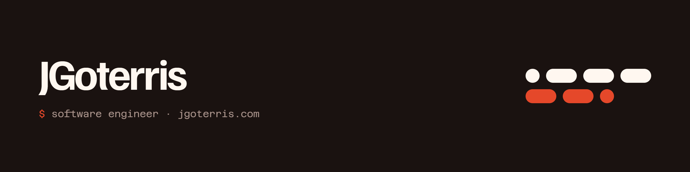

<div align="center">



[](https://jgoterris.com)
[](https://www.linkedin.com/in/jgoterris/)
[](mailto:contact@jgoterris.com)

</div>

Software engineer at **Nealis Tech**, building AI-powered applications end to end, from backend and frontend to infrastructure. Lately I'm writing **Go** and learning **Rust**.

```yaml
now:        end-to-end AI applications @ Nealis Tech
before:     federated learning research @ GEOTEC · E2E test automation (Playwright)
education:  BSc Computer Engineering (Software), Universitat Jaume I — 9.43/10, thesis with honours
location:   Spain
```

## Stack


<br>


<br>


## Featured projects

| Project | Description | Stack |
| --- | --- | --- |
| [**Orbit**](https://github.com/JGoterris/orbit) | TUI to launch, control and monitor local services. | Go · Bubble Tea · Docker |
| [**LIA-FL**](https://github.com/GeoTecINIT/LIA_System) | Containerised federated learning platform for AIoT time-series forecasting, with group-based federation over MQTT. | Python · MQTT · Docker |
| [**GastoBot**](https://github.com/JGoterris/GastoBot) | Telegram bot that extracts expenses from text, voice notes and receipt photos, and logs them to Google Sheets. | Python · Gemini · Telegram API |
| [**Mappets**](https://github.com/JGoterris/Mappets) | Android app that plans routes by time, distance or cost and estimates the effort of each transport mode. | Kotlin · Jetpack Compose · Firebase · Mapbox |
| [**SongRecommendations**](https://github.com/JGoterris/SongRecommendations) | Desktop app that recommends songs from a preloaded catalogue. | Java · JavaFX |

Most of my professional work lives in private repos. More on **[jgoterris.com](https://jgoterris.com)**.
